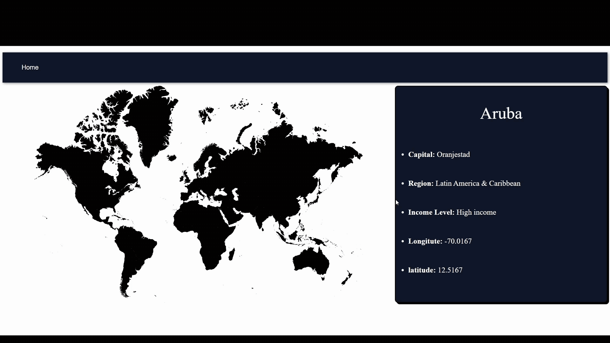

# Interactive World Map

A responsive Angular web application featuring an interactive world map that displays country-specific information.

## Demo


## Features

- **Interactive Map:** Hover over countries to highlight them and explore country-specific information.
- **API Integration:** Retrieve country data dynamically from an API.
- **Dynamic Data Display:** View demographic information for selected countries.

## Technologies Used

- Angular
- TypeScript
- JavaScript
- SVG
- REST API Integration
- HTML and CSS

## Getting Started

1. Clone the repository.
2. Install dependencies:

   ```bash
   npm install
   ```

3. Start the development server:

   ```bash
   ng serve --open
   ```

## Author

**Jake Black**

- LinkedIn: [Jake Black](https://www.linkedin.com/in/blackjacj/)
